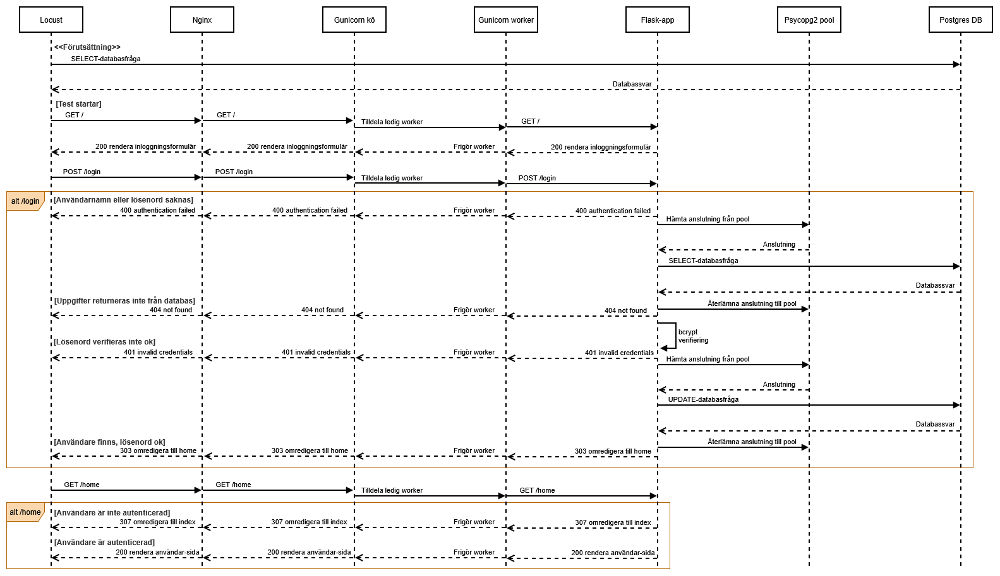

# Beskrivning
Detta projekt har skapats för kursen PA1438 på BTH. Syftet är att modellera de väntetider som en användare kan uppleva då många samtidiga användare kan logga in, och var dessa väntetider kan uppträda.

Projektet innehåller filer för att sätta upp en enkel login-applikation, belasta applikationen med samtidiga användare som loggar in, samt mäta svarstider och resursbelastningen.

Projektet är uppdelat i:
- Applikationen med login-funktionen.
- Locust-skriptet som simulera samtidiga användare som loggar in i applikationen.
- Databasen med användarens uppgifter, som används både av applikationen och Locust-skriptet.

## Sekvensdiagram för projektet


## Login-app
Login-applikationen har byggts i Flask, och innehåller router för index, login och home:
- Index-routen: Renderar ett HTML-formulär där användaren anger användarnamn och lösenord. Uppgifterna skickas med HTTP POST-anrop till login-routen.
- Login-routen: Tar emot användarens login-uppgifter och verifierar dem. Användarens uppgifter hämtas från databasen, och lösenordet autentiseras med hashing-algoritmen Bcrypt. När uppgifterna har autentiserats, uppdateras databasen med tidsstämpel för senaste inloggning. Användarens uppgifter skrivs till session, och användaren dirigeras sedan till home-routen.
- Home-routen: Renderar användarens inloggade HTML-sida, hämtar användarens uppgifter från session och visar upp på sidan.

### Bcrypt och kostnadsfaktor
Alla användares lösenord har lagrats i databasen som bcrypt-hashar med kostnadsfaktor 10. Hashen innehåller både salt och kostnadsfaktor. När lösenordet verifieras används samma salt och kostnadsfaktor för att hasha lösenordet som användaren använt vid inloggning, och jämför detta med den lagrade lösenords-hashen från databasen.

Bcrypt är avsiktligt beräkningstungt för att försvåra lösenords-attacker. Kostnadsfaktorn är en exponent som styr hur tung beräkningen är. Faktor 10 innebär att bcrypt kör krypteringsprocessen 2^10 (1024) varv efter varandra. Det påverkar både exekveringstiden och CPU-belastningen. Varje hashning är CPU-bunden och enkeltrådad, och upptar en CPU-kärna medan den pågår.

## Locust-skript
För att belasta inloggningsapplikationen med samtidiga användare används Python-biblioteket Locust. Testskriptet är utformat för att simulera ett specificerat antal virtuella användare som skickar anrop till en given route. Inledningsvis hämtas samtliga användarnamn från databasen och lagras i en lista. Vid varje nytt inloggningsförsök väljs ett slumpmässigt användarnamn från listan. För enkelhets skull har alla användare samma lösenord.

Varje användare som skapas i Locust fungerar som en egen isolerad webbläsare. De cookies som skapas under sessionen sparas till den specifika användaren. I slutet av varje inloggningflöde rensar skriptet cookies, så att dessa inte skickas automatiskt i nästkommande flöden. 

För att minska risken för att Locust utgör en flaskhals körs belastningstesterna i distribuerat läge med en master-process och flera worker-processer. Applikationen förväntas bli mättat vid en relativt låg nivå av samtidiga användare, därför bedöms den valda konfigurationen vara tillräcklig för testernas syfte. 

## Webbserver
Projektet använder Gunicorn tillsammans med Nginx för att serva Flask-applikationen. Nginx är en webbserver som ligger framför Gunicorn och tar emot och vidarebefordrar alla HTTP-anrop som anländer från Locust. Gunicorn är en Python Web Server Gateway Interface (WSGI) server, vilket innebär att den tar emot HTTP-anrop från Nginx, och översätter dem till WSGI-formatet som Flask-applikationen kan hantera, så att applikationen kan köras och returnera ett svar. 

Tanken med projektet är att vara produktionslikt, utan medvetet inbyggda felkällor som kan försämra prestandan vid högre belastningsnivåer. Därför används Gunicorn och Nginx istället för Pythons inbyggda utvecklingsserver, eftersom denna inte är utformad för att hantera högre belastning, eller flera samtidiga work-processer. I Gunicorn är det möjligt att styra hur många anrop som kan hanteras parallellt, exempelvis genom att konfigurera antal workers och trådar. 

Eftersom verifieringen med bcrypt upptar CPU-kärnor vid hashning, anpassas antalet workers utifrån tillgängliga CPU-kärnor. Med den tillgängliga hårdvaran motsvarar detta fyra workers. Eftersom applikationen även utför flera I/O-operationer, som databasanrop, använder projektet Gunicorns worker-typ gthreads. Gthreads möjliggör för flera trådar per worker, där varje tråd kan hantera ett anrop. För att förhindra att inkommande anrop fastnar i Gunicorns backlog i ett tidigt skede, har antalet trådar per worker satts till sex stycken. 

Projektets kombination av workers och trådar innebär att maximalt 4 workers * 6 trådar = 24 anrop kan hanteras samtidigt inuti applikationen. Om en ny anslutning görs när alla workers är upptagna, kommer den att hamna i Gunicorns backlog. Som storlek på Gunicorns backlog används standardvärdet på 2048. Om antalet anslutningar i backlog överstiger 2048, kommer nya klienter som försöker ansluta få ett felmeddelande. För att säkerställa att workers inte fastnar, använder Gunicorn timeout. I projektet används Gunicorns standard timeout om 30 sekunder. Det innebär att en worker som har varit stilla i 30 sekunder kommer att avbrytas och starta om. 

## Databas
Som databashanterare används PostgreSQL, och databasen skapas i Docker-containern utifrån Postgres officiella Docker-image. Den innehåller en tabell med användarens uppgifter, såsom namn, användarnamn, hashat-lösenord, och tidsstämpel för senaste inloggning. Databas-tabellen seedas med användaruppgifter som genereras med Pythons Faker-bibliotek, samt hashade-lösenord. 

Databasen används i Locust-skriptet för att hämta användarnamn att logga in med. Databasen används också i applikationen för att hämta användarens uppgifter, och för att uppdatera tabellen med tidsstämpel för senaste inloggning.

Databasanslutningarna hanteras med hjälp av psycopg2-anslutningspool. En anslutningspool är en samling återanvändbara databasanslutningar, där applikationen som ska utföra en databasoperation lånar en anslutning, utför databasoperationen och lämnar tillbaka anslutningen. Eftersom projektet använder en webbserver i flertrådat läge, används klassen ThreadedConnectionPool, där anslutningspoolen kan delas av flera trådar.

Varje Gunicorn worker motsvarar en egen process, med en egen databaspool. Därför konfigureras databaspoolens storlek utifrån antalet trådar som varje worker har, det vill säga sex trådar. Med fyra workers innebär det att 4 * 6 = 24 anslutningar maximalt förväntas göras mot databasen samtidigt. 

## Hårdvara och nätverk
...

# Installation
För att köra projektet behöver Docker och Chrony vara installerat på alla maskiner. Dessutom ska en DPMI-mätpunkt sättas upp, för att kunna mäta nätverkstrafiken. Nedan beskrivs hur Docker och Chrony kan installeras med hjälp av Ansible-playbooks, som finns tillgängliga i katalogen som heter Ansible.

## Ansible
Ansible är en automations-plattform som används för konfigurationshantering, applikationsdistribution och orkestrering av IT-miljöer. Med hjälp av Ansible kan projektet styras från en separat dator, eftersom Ansible kommunicerar direkt med maskinerna genom SSH-protokoll. 

Ansible behöver inte installeras på maskinerna som kör projektet, däremot behöver det vara installerat på maskinen som ska köra Ansible. 

En utförlig beskrivning för att installera Ansible finns på: [Ansible docs](https://docs.ansible.com/projects/ansible/latest/installation_guide/intro_installation.html)

För att installera Ansible på Ubuntu körs följande kommandon:
```console
sudo apt update
sudo apt install software-properties-common
sudo add-apt-repository --yes --update ppa:ansible/ansible
sudo apt install ansible
```
Kontrollera att Ansible har installerats korrekt:
```console
ansible --version
```
Installera Ansible collection, för att kunna köra Ansible-playbooks som finns i katalogen:
```console
ansible-galaxy collection install community.general
```
Verifiera att Ansible collection har installerats:
```console
ansible-galaxy collection list
```
För att kunna köra Ansible-playbooks ska korrekta IP-adresser till maskinerna anges i filen inventory.yml

## Docker 
Docker Engine är en container-teknologi som möjliggör för att köra en applikation och alla dess beroenden inom en isolerad miljö (container). Projektet förutsätter att Docker Engine finns installerat på alla maskiner, eftersom alla delar körs i Docker-containrar. 

En utförlig beskrivning om hur Docker installeras på Ubuntu finns på: [Docker docs](https://docs.docker.com/engine/install/ubuntu/#install-using-the-repository )

Installera Docker genom att köra den Ansible-playbook som installerar Docker och Docker compose på alla maskiner:
```console
ansible-playbook -i inventory install-docker.yml
```
Verifiera att Docker har installerats korrekt:
```console
docker --version
docker compose version
```

I katalogen för Deploy finns docker-compose-filer för att starta projektet på tre separata maskiner. Alla docker-compose-filer utgår från existerande publika Docker-images. Nya Docker-images kan byggas utifrån de Docker-filer som finns i respektive katalog för App, Database, Locust. I maskinen som kör applikationen ska separata Docker-containrar köras för Nginx och en för Gunicorn + Flask. För att kunna köra projektet behöver korrekta IP-adresser för varje host anges som environment-variablar i respektive fil.

Docker-compose-filen för databasen kommer att skapa en databas-tabell utifrån det schema som finns i filen schema.sql, i katalogen Database. Tabellen kommer fyllas med användar-uppgifter utifrån seed-skriptet som finns i samma katalog. 

## Chrony
Chrony är ett protokoll som bygger på Network Time Protocol (NTP), och används för att synkronisera klockor över ett nätverk. Chrony installeras på alla maskiner, eftersom klockorna på de olika maskinerna behöver vara synkroniserade, så att maskinenrnas resursutnyttjande kan jämföras. För att synkronisera klockorna mellan maskinerna, ska en maskin sättas upp som en NTP-server, medan de andra är NTP-klienter. För projektet används maskinen som kör Locust som NTP-server, medans maskinerna som kör applikationen och databasen är klienter.

Installera Chrony genom att köra Ansible-playbook:
```console
ansible-playbook -i inventory install-chrony.yml
```
Kontrollera att tjänsten chronyd är aktiv:
```console
systemctl status chronyd
```

## Distributed Passive Measurement Infrastructure
Distributed Passive Measurement Infrastructure (DPMI) är ett ramverk för nätverksövervakning som använder sensorer utplacerade över flera nätverksdomäner för att samla in, bearbeta och analysera pakettrafik. 

I labbmiljön placeras en DPMI-mätpunkt mellan Locust och applikationsservern för att mäta nätverkstrafiken. Eftersom den mäter både anrop och svar med samma klocka kan serverns totala svarstid mätas utan klocksynkronisering. Resultatet kan jämföras med Locusts svarstid och Flasks route-tid. Mätpunkten kan även upptäcka TCP-problem, exempelvis SYN-retransmissioner vid full backlog. 

# Testkörning
Innan testkörningarna påbörjas, initieras systemmiljön genom att docker-compose-filer distribueras och startas på respektive maskin. Detta automatiseras med en Ansible-playbook som kopierar konfigurationsfilerna och startar upp Docker-containrarna på respektive maskin.

Kör den Ansible-playbook som kopierar Docker-compose-filerna och startar containrarna: 
```console
ansible-playbook -i inventory deploy.yml
```

För att genomföra belastningtesterna används en separat Ansible-playbook: run_test.yml. Denna playbook interagerar med Locust API via dess webbgränssnitt. IP-adressen till maskinen som kör Locust ska anges i anropssträngen. Testets belastningsprofil konfigureras i anropets payload med följande parametrar:

- user_count: totala antalet samtidiga virtuella användare
- spawn_rate: accelerationstakt (antal användare som läggs till per sekund under uppvärmningsfasen).
- run_time: testets totala körtid, inklusive tiden för upptrappning och nedtrappning.

Genom att uppdatera dessa parametrar kan systemet utvärderas utifrån de fyra belastningsnivåer som beskrivs nedan. För att få minimera effekter av outlier-värden och få tillförlitliga genomsnittsvärden för genomströmning och svarstider, upprepas testkörningarna för varje belastningsnivå tre gånger. 

## Locust webbgränssnitt för att ange antal användare och körningstid


## Belastningsnivåer
För att se hur systemet påverkas av belastning, utförs testerna under fyra belastningsnivåer:
- Låg belastning: En nivå där systemet utsätts för minimal belastning. Syftet är att fastställa en baslinje för svarstider och genomströmning.
- Optimal belastning: En nivå där systemet kan hantera en högre belastning med god prestanda Genomströmningen är på sin maximala nivå, utan att svarstiderna ökar. 
- Hög belastning: En nivå där systemet precis överstiger sin kapacitetsgräns. Genomströmningen ligger på sin maximala nivå, men svarstiderna ökar. 
- Överbelastning: En nivå där belastningen överstiger systemets förmåga att hantera anropen med acceptabel prestanda. Detta kan medföra kraftigt ökade svarstider, felaktiga anrop eller minskad genomströmning.

Före mätningarna görs en överslagsberäkning av dessa nivåer, för att kunna förutsäga var systemet mättas. För dessa beräkningar används Littles sats, vilket är en formel som beskriver sambandet mellan antalet anrop i ett system, genomströmningen, och tiden som anropet spenderar i systemet. Littles sats beskrivs som: $N = \lambda  \times W$ , där $\lambda$ i sammanhanget för detta projekt motsvarar genomströmningen (anrop per sekund), och $W$ motsvarar den totala svarstiden för ett enskilt anrop. Med dessa uppgifter kan man beräkna $N$ , vilket motsvarar det genomsnittliga antalet anrop som kan vara aktiva i systemet samtidigt, alltså belastningsnivån. 

För att estimera svarstiden $W$ behöver både tiden som processorn utför en uppgift, och tiden för att vänta på I/O, tas med i beräkningen. För projektet kommer hashningen med bcrypt utgöra den största CPU-bundna tiden. Med kostnadsfaktor 10 uppskattas denna tid till 0,1s. Projektet har flera uppgifter som innebär I/O-väntan, som nätverkstransport, databasanrop och nedladdning av HTML-sidor. Denna tid uppskattas till 0,05s. Den totala svarstiden för ett enskilt anrop beräknas därmed till: $W=0,1 + 0,05 = 0,15s$

Eftersom hashningen med bcrypt är CPU-bunden, kommer detta att bestämma de fysiska begränsningar som systemet har. En CPU-kärna kan bara hantera en bcrypt-hashning vid ett givet tillfälle, vilket innebär maximalt 1 CPU-kärna / 0,1s = 10 anrop per sekund. Med fyra CPU-kärnor innebär det att den maximala genomströmningen som systemet kan hantera är:
$\lambda_{text{max}} = \frac{4}{0,1} = 40\ \text{anrop/s}$

# Datainsamling
Vid varje testkörning per belastningsnivå samlas data med loggade svarstider och resursanvändning in. Datan som samlas in beskrivs nedan.

## Loggning
I Locust-skriptet loggas data för varje anrop som skickas, och sparas i en .jsonl fil. I Locust genereras ett anrops-id som följer med till loggningen i Login-applikationen, så att svarstiden i Locust kan jämföras med exekveringstiden för applikationen. 
Datan som loggas i Locust är:
- Anrops-id
- Starttid för anrop
- Namn på route som anrop skickas till
- Svarstid, alltså tiden från att anropet skickats till att svar kommer tillbaka
- Eventuella exceptions
  
För login-applikationen loggas den totala tiden för att exekvera varje route med Python-biblioteket logger. Loggarna sparas till en jsonl-fil. För login-routen loggas utöver den totala tiden för att exekvera routen även följande data:
- Tid för att göra SELECT-anrop till databasen
- Tid för att göra UPDATE-anrop till databasen
- Tider för att ansluta till databas-pool för SELECT och UPDATE-anrop
- Tid för att verifiera hashat lösenord med Bcrypt

Log-filerna sparas till logs-katalogen på host-enheten och data-katalogen i containern.

## Resursmätning


# Visualisering av inloggning


