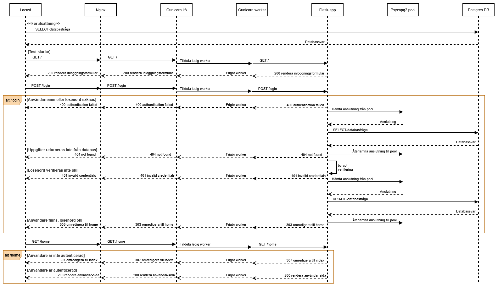
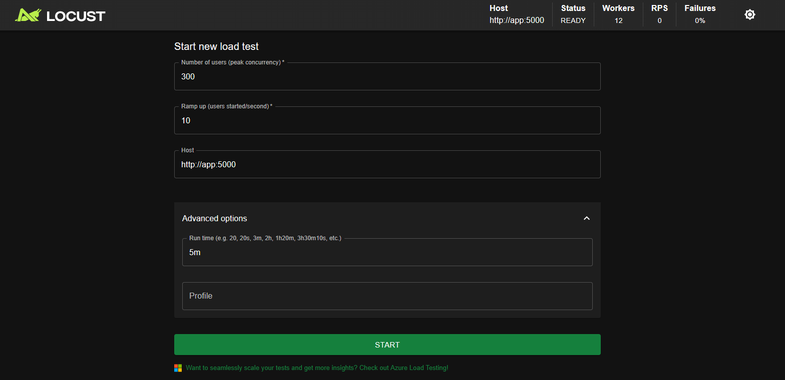

# Beskrivning
Detta projekt har skapats för kursen PA1438 på BTH. Syftet är att modellera de väntetider som en användare kan uppleva då många samtidiga användare kan logga in, och var dessa väntetider kan uppträda.

Projektet innehåller filer för att sätta upp en enkel login-applikation, belasta applikationen med samtidiga användare som loggar in, samt mäta svarstider och resursbelastningen.

Projektet är uppdelat i:
- Applikationen med login-funktionen.
- Locust-skriptet som simulera samtidiga användare som loggar in i applikationen.
- Databasen med användarens uppgifter, som används både av applikationen och Locust-skriptet.

## Sekvensdiagram för projektet


## Login-app
Login-applikationen har byggts i Flask, och innehåller router för index, login och home:
- Index-routen: Renderar ett HTML-formulär där användaren anger användarnamn och lösenord.
- Login-routen: Tar emot användarens login-uppgifter och verifierar dem. Användarens uppgifter hämtas från databasen, och lösenordet autentiseras med hashing-algoritmen Bcrypt. När uppgifterna har autentiserats, uppdateras databasen med tidstämpel för senaste inloggning. Användarens uppgifter skrivs till session, och användaren dirigeras sedan till home-routen.
- Home-routen: Renderar användarens inloggade hemsida, hämtar användarens uppgifter från session och visar upp på sidan.

### Bcrypt och kostnadsfaktor
Alla användares lösenord har lagrats i databasen som bcrypt-hashar med kostnadsfaktor 10. Hashen innehåller både salt och kostnadsfaktor. När lösenordet verifieras används samma salt och kostnadsfaktor för att hasha lösenordet som användaren använt vid inloggning, och jämför detta med den lagrade lösenords-hashen från databasen.

Bcrypt är avsiktligt beräkningstungt för att försvåra lösenords-attacker. Kostnadsfaktorn är en exponent som styr hur tung beräkningen är. Faktor 10 innebär att 2^10 (1024) rundor i bcrypts nyckelschema utförs. Det påverkar både exekveringstiden och CPU-belastningen. Varje hashning är CPU-bunden och enkeltrådad, och upptar en CPU-kärna medan den pågår. Tiden för att hasha lösenordet med kostnadsfaktor 10 uppskattas till 50 - 100 millisekunder. 

## Locust-skript
För att belasta inloggningsapplikationen med samtidiga användare används Python-biblioteket Locust. Testskriptet är utformat för att simulera ett specificerat antal virtuella användare som skickar anrop till en given route. Inledningsvis hämtas samtliga användarnamn från databasen och lagras i en lista. Vid varje nytt inloggningsförsök väljs ett slumpmässigt användarnamn från listan. För enkelhets skull har alla användare samma lösenord.

Varje användare som skapas i Locust fungerar som en egen isolerad webbläsare. De cookies som skapas under sessionen sparas till den specifika användaren. I slutet av varje inloggningflöde rensar skriptet cookies, så att dessa inte skickas automatiskt i nästkommande flöden. 


## Webbserver
Projektet använder Gunicorn tillsammans med Nginx för att serva Flask-applikationen. Nginx är en webbserver som ligger framför Gunicorn och tar emot och vidarebefordrar alla HTTP-anrop som anländer från Locust. Gunicorn är en Python Web Server Gateway Interface (WSGI) server, vilket innebär att den tar emot HTTP-anrop från Nginx, och översätter dem till WSGI-formatet som Flask-applikationen kan hantera, så att applikationen kan köras och returnera ett svar. 

Tanken med projektet är att vara produktionslikt, utan medvetet inbyggda felkällor som kan försämra prestandan vid högre belastningsnivåer. Därför används Gunicorn och Nginx istället för Pythons inbyggda utvecklingsserver, eftersom denna inte är utformad för att hantera högre belastning, eller flera samtidiga work-processer. I Gunicorn är det möjligt att styra hur många anrop som kan hanteras parallellt, exempelvis genom att konfigurera antal workers och trådar. 

Eftersom verifieringen med bcrypt upptar CPU-kärnor vid hashning, anpassas antalet workers utifrån tillgängliga CPU-kärnor. Med den tillgängliga hårdvaran motsvarar detta fyra workers. Eftersom applikationen även utför flera databasoperationer, använder projektet Gunicorns workertyp gthreads. Gthreads möjliggör för flera trådar per worker, där varje tråd kan hantera ett anrop. För att antalet trådar ska matcha tillgängliga storleken på databaspoolen (se stycket om databasens konfiguration), hålls antalet trådar per worker till två.

Projektets kombination av workers och trådar innebär att maximalt 4 workers * 2 trådar  = 8 anrop kan hanteras samtidigt vid en given tidpunkt. Om en ny anslutning görs när alla workers är upptagna, kommer den att hamna i Gunicorns backlog. Som storlek på Gunicorns backlog används standardvärdet på 2048. Om antalet anslutningar i backlog överstiger 2048, kommer nya klienter som försöker ansluta få ett felmeddelande. För att säkerställa att workers inte fastnar, använder Gunicorn timeout. I projektet används Gunicorns standard timeout om 30 sekunder. Det innebär att en worker som har varit stilla i 30 sekunder kommer att avbrytas och starta om. 

## Databas
Som databashanterare används PostgreSQL, och databasen skapas i Docker-containern utifrån Postgres officiella Docker-image. Den innehåller en tabell med användarens uppgifter, såsom namn, användarnamn, hashat-lösenord, och tidsstämpel för senaste inloggning. Databas-tabellen seedas med användaruppgifter som genereras med Pyhtons Faker-bibliotek, samt hashade-lösenord. 

Databasen används i Locust-skriptet för att hämta användarnamn att logga in med. Databasen används också i applikationen för att hämta användarens uppgifter, och för att uppdatera tabellen med tidsstämpel för senaste inloggning.

Databasanslutningarna hanteras med hjälp av psycopg2-anslutningspool. En anslutningspool är en samling återanvändbara databasanslutningar, där applikationen som ska utföra en databasoperation lånar en anslutning, utför databasoperationen och lämnar tillbaka anslutningen. Eftersom projektet använder en webbserver i flertrådat läge, används klassen ThreadedConnectionPool, där anslutningspoolen kan delas av flera trådar.

Varje Gunicorn worker motsvarar en egen process, med en egen databaspool. Därför konfigureras databaspoolens storlek utifrån antalet trådar som varje worker har, det vill säga två trådar. Med fyra workers innebär det att 4 * 2 = 8 anslutningar maximalt förväntas göras till databasen samtidigt. För att verifiera mot databasens maxkapacitet för antal anslutningar kan formeln: (2 * antal CPU-kärnor) + antalet effektiva diskar, användas. Med den tillgängliga hårdvaran beräknas detta till nio anslutningar, vilket är tillräckligt för de beräknade anslutningarna ovan.

## Hårdvara och nätverk

# Installation
För att köra projektet behöver Docker, Ansible, DPMI och Chrony vara installerat, vilket beskrivs nedan. 

## Docker 
Docker Engine är en kontainer-teknologi som möjliggör för att köra en applikation och alla dess beroenden inom en isolerad miljö (container). Projektet förutsätter att Docker Engine finns installerat på alla maskiner, eftersom alla delar körs i Docker-containrar. 

En utförlig beskrivning om hur Docker installeras på Ubuntu finns på: [Docker docs](https://docs.docker.com/engine/install/ubuntu/#install-using-the-repository )

Nedan följer en beskrivning om hur Docker Engine installeras i Ubuntu med hjälp av Dockers apt-repository:
```console
# Add Docker's official GPG key:
sudo apt update
sudo apt install ca-certificates curl
sudo install -m 0755 -d /etc/apt/keyrings
sudo curl -fsSL https://download.docker.com/linux/ubuntu/gpg -o /etc/apt/keyrings/docker.asc
sudo chmod a+r /etc/apt/keyrings/docker.asc

# Add the repository to Apt sources:
sudo tee /etc/apt/sources.list.d/docker.sources <<EOF
Types: deb
URIs: https://download.docker.com/linux/ubuntu
Suites: (./etc/os-release&&echo"{UBUNTU_CODENAME:-$VERSION_CODENAME}")
Components: stable
Architectures: $(dpkg --print-architecture)
Signed-By: /etc/apt/keyrings/docker.asc
EOF

sudo apt update
```
För att installera senaste versionen av Docker-paketen körs:
```console
sudo apt install docker-ce docker-ce-cli containerd.io docker-buildx-plugin docker-compose-plugin
```
För att verifiera att Docker körs:
```console
sudo systemctl status docker
```

I katalogen för Deploy finns docker-compose-filer för att starta projektet på tre separata maskiner. För att kunna köra projektet behöver korrekta IP-adresser för varje host anges som environment-variablar i respektive fil. Alla docker-compose-filer utgår från existerande publika Docker-images. Nya Docker-images kan byggas utifrån de Docker-filer som finns i respektive katalog för App, Database, Locust. I maskinen som kör applikationen ska separata Docker-containrar köras för Nginx och en för Gunicorn + Flask.

Docker-compose-filen för databasen kommer att skapa en databas-tabell utifrån det schema som finns i filen schema.sql, i katalogen Database. Tabellen kommer fyllas med användar-uppgifter utifrån seed-skriptet som finns i samma katalog. 

## Ansible
Ansible är en automations-plattform som används för konfigurationshantering, applikationsdistribution och orkestrering av IT-miljöer. Med hjälp av Ansible kan projektet styras från en separat dator, eftersom Ansible kommunicerar direkt med maskinerna genom SSH-protokoll. Ansible behöver inte installeras på maskinerna som kör projektet, däremot behöver det vara installerat på maskinen som ska köra Ansible. 

En utförlig beskrivning för att installera Ansible finns på: [Ansible docs](https://docs.ansible.com/projects/ansible/latest/installation_guide/intro_installation.html)

För att installera Ansible på Ubuntu kan följande kommandon köras:
```console
sudo apt update
sudo apt install software-properties-common
sudo add-apt-repository --yes --update ppa:ansible/ansible
sudo apt install ansible
```


# Testkörning
För att köra en testomgång där applikationen belastas med samtidiga användare som försöker logga in, börjar man med att starta alla containrar med kommandot docker compose up -d. Genom att köra kommandot docker compose logs på enheten som har containern för Locust-skriptet, kan man se adressen för Locust webbgränssnitt, exempelvis http://0.0.0.0:8089.

Testkörningen startas genom att i Locust webbgränssnitt ange antalet samtidiga användare, hur många användare som ska läggas till per sekund tills man har uppnått antalet samtidiga användare, samt hur länge körningen ska pågå. På så sätt kan applikationen testas under olika nivåer av belastning. För att testa en låg belastning kan exempelvis antalet användare vara 5, där 1 användare läggs till för att komma upp till 5, och att körningen varar i 3 minuter.

## Locust webbgränssnitt för att ange antal användare och körningstid


# Loggning
I Locust-skriptet loggas data för varje anrop som skickas, och sparas i en .jsonl fil. I Locust genereras ett anrops-id som följer med till loggnignen i Login-applikationen, så att svarstiden i Locust kan jämföras med exekveringstiden för applikationen. 
Datan som loggas i Locust är:
- Anrops-id
- Starttid för anrop
- Namn på route som anrop skickas till
- Svarstid, alltså tiden från att anropet skickats till att svar kommer tillbaka
- Eventuella exceptions
  
För login-applikationen loggas den totala tiden för att exekvera varje route med Python-biblioteket logger. Loggarna sparas till en jsonl-fil. För login-routen loggas utöver den totala tiden för att exekvera routen även följande data:
- Tid för att göra SELECT-anrop till databasen
- Tid för att göra UPDATE-anrop till databasen
- Tider för att ansluta till databas-pool för SELECT och UPDATE-anrop
- Tid för att verifiera hashat lösenord med Bcrypt

Log-filerna sparas till logs-katalogen på host-enheten och data-katalogen i containern.

# Visualisering av inloggning


